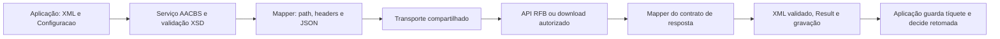

# Plano de execução AACBS

Revisão de 24/11/2026 — AACBS-000, tentativa-0002. Preserva as decisões iniciais e incorpora o catálogo e os contratos publicados em 13/11, além do preparo local de acesso solicitado pelo DEV.

## Objetivo e limite da entrega

Integrar todas as operações publicadas no conjunto de apuração assistida CBS à Unimake.DFe, oferecendo contratos XML documentados e tipados, XSDs de envio e retorno e um serviço por endpoint. O inventário atual possui oito endpoints de negócio: quatro solicitações de consulta, situação, link de download e dois geradores de DARF. Com autenticação e download externo, são dez serviços planejados.

O sucesso observável é executar o ciclo das quatro famílias assíncronas — solicitação, situação, link e download — e os dois serviços síncronos de geração de DARF a partir de XML, obtendo XML validável e `Result` utilizável em .NET e INTEROP, com os dados e erros do contrato remoto preservados. Cada chamada continua explícita. A aplicação guarda o tíquete e decide a próxima chamada; o roteiro de testes atua como essa aplicação consumidora, sem introduzir polling na DLL.

Não fazem parte deste primeiro escopo: API IBS sem documentação própria, calculadora tributária, conclusão de apuração mencionada apenas em material antigo sem endpoint vigente neste conjunto, pagamento de DARF/PIX, download de PDF sem contrato qualificado, hospedagem de webhook, agendamento, banco de dados, reconciliação contábil, telas, adaptação do UniNFe/PRO e publicação no nuget.org. A configuração de `urlRetorno` pode ser suportada; o fluxo completo inicial usará consulta de situação. Não é necessário que o consumidor implemente JSON para usar esse fluxo.

## Base verificada e desenho

O inventário de fontes e lacunas está em [FONTES-E-REQUISITOS.md](FONTES-E-REQUISITOS.md). A correspondência inicial entre endpoints, serviços e contratos está em [MATRIZ-APIS.md](MATRIZ-APIS.md). O mapa de código e a estratégia de verificação estão em [ARQUITETURA-E-TESTES.md](ARQUITETURA-E-TESTES.md).

- Criar uma base fiscal `Servicos/AACBS/ServicoBase.cs`, configuração nacional e mappers do domínio. Reutilizar o transporte atual; não reproduzir provedores ou normalizações ANTT/eFrete.
- Usar classes em `Xml/AACBS`, XSDs em `Xml/Schemas/AACBS`, configuração em `Servicos/Config/AACBS` e validações de conteúdo em `Validator/AACBS`, quando necessárias.
- Adicionar valores explícitos de `TipoDFe` e `Servico` sem mudar os números existentes. Registrar recursos no projeto e integrar a detecção de XML/versão e o catálogo de validação existentes.
- O namespace XML é o contrato Unimake `http://www.unimake.com.br/dfe/aacbs`, versão 1.00, aprovado na AACBS-001. Os XSDs produzidos por nós não serão apresentados como schemas oficiais da Receita. Versão XML e versão HTTP são identificadores independentes.
- Expor o padrão `Envio`, `Result`, inicialização por objeto/XML e métodos INTEROP. A autenticação será preparada pela DLL; o DEV não precisará manipular JSON ou renovar tokens manualmente. O serviço auxiliar de autenticação também será especificado, sem exigir seu uso direto no fluxo habitual.
- O download terá contexto explícito da família solicitada e resultado tipado para os quatro layouts. A especificação definirá raízes e eventual envelope, com um mapeamento rastreável de cada campo remoto; não haverá um campo genérico contendo o JSON inteiro como substituto do modelo XML.
- Os dois DARFs são síncronos: RAD recebe array de solicitações por DF-e e PCONT recebe objeto por período, com CNPJ completo de 14 posições conforme as instruções atuais. Eles não usam tíquete nem o download assíncrono. Preservar no XML código de retorno, dados do DARF, PIX, código de barras, link PDF e valores, sem iniciar pagamento.
- As seis publicações de JSON Schema oficiais serão confrontadas com tabelas e exemplos antes de derivar nossos XSDs. Não são schemas XML nem substituem a validação do contrato Unimake; existem divergências entre os próprios artefatos oficiais.
- A gravação dos XMLs seguirá o contrato de métodos da biblioteca. A aplicação escolhe quando e onde gravar; a observação passiva não fará essa persistência.

## Execução e gates

Status, aprovação e histórico ficam exclusivamente no [PDCA.md](PDCA.md). O orquestrador só distribui tarefas da etapa liberada. A aprovação do DEV libera a sucessora; ao terminar uma entrega, a equipe para em `DELIVERED_FOR_REVIEW`.

Dentro da etapa liberada, o pedido de 24/11 permite executar e corrigir os testes previstos sem solicitar ação do DEV para cada chamada, respeitando empresa, ambiente, cenários, cotas e condições de parada. O preparo concreto está em [ACESSO-LOCAL.md](ACESSO-LOCAL.md). O DEV aprovou a AACBS-000 e a AACBS-001 e liberou a AACBS-002, agora entregue para revisão. A configuração local foi verificada sem expor valores; isso não comprova autenticação ou autorização remota. Estado e aprovações atuais ficam no PDCA.

### AACBS-000 — Planejamento inicial

**Entrega:** este plano, decisões da entrevista, inventário inicial de endpoints, referências do CIOT, requisitos de ambiente, lacunas conhecidas, papéis dos agentes e modelo de evidências.

**Aceitação:** arquivos navegáveis; distinção entre fatos, decisões e propostas; etapas executáveis e abrangentes; nenhum código da biblioteca ou serviço fiscal alterado; nenhuma chamada de negócio realizada. Na revisão de 24/11, o preparador local de acesso apenas guarda/verifica configuração e não implementa autenticação ou serviços. O DEV revisa a sigla, o escopo e a sequência antes de liberar a AACBS-001.

### AACBS-001 — Qualificação das fontes e especificação dos contratos

**Entrada:** AACBS-000 aprovada. Esta etapa altera apenas a documentação do plano e suas fontes técnicas.

**Trabalho:**

1. Obter a documentação técnica vigente de autenticação Receita Integra indicada pela RFB. Confirmar método, URI, headers, body, escopos, resposta, expiração, renovação e requisitos de acesso por ambiente. Distinguir acesso humano ao portal de autenticação do transporte.
2. Qualificar os oito endpoints de negócio, autenticação, download externo e os seis JSON Schemas Draft 2020-12 publicados. Registrar versão/data e SHA-256 dos arquivos técnicos efetivamente obtidos; para HTML, conservar a referência e uma captura textual datada com hash quando viável. Comparar conteúdo mesmo quando a versão publicada não mudar, como aconteceu na página de download. Uma alteração de fonte exige avaliar o diff do contrato, sem importar automaticamente novas regras.
3. Produzir uma matriz por campo: origem documental; path/header/body/response; nome JSON; nome e caminho XML; tipo C#; tipo/restrição XSD; cardinalidade; ausente/vazio/zero/null; formato; regra condicional; serviço e teste correspondente. Cobrir respostas imediatas, situação, link, autenticação, erros, quatro arquivos finais e dois DARFs. Separar CNPJ base das consultas e CNPJ completo dos DARFs; distinguir data de instante com offset.
4. Resolver e registrar as divergências atuais entre tabela, narrativa, exemplo e JSON Schema: `dataMaximaPagamento`/`dataVencimento` nos DARFs; vencimento RAD como data ou date-time; request RAD em lote com retorno documentado único; CNPJ RAD 14/8 no exemplo. Marcar as divergências antigas corrigidas como históricas. Esclarecimento oficial ou resposta real legitimamente obtida pode fornecer evidência; uma resposta isolada não resolve sozinha todas as regras de cardinalidade. Quando não houver resposta, propor ao DEV uma representação conservadora e explicitar seu limite antes da aprovação.
5. Definir nomes públicos, raízes, namespace Unimake, versão inicial, schemas comuns/por operação e resultado de download por família. Definir tratamento de campos/códigos novos sem perda silenciosa, política de erro HTTP/aplicação e comportamento de retorno incompatível.
6. Especificar a configuração de credenciais, isolamento de token por identidade/ambiente, proteção do link temporário e preservação de códigos HTTP. O manual Receita Integra 1.4 informa uma hora de validade, dois tokens por hora e cache obrigatório: o roteiro deve reutilizar cache cifrado entre execuções, sem autenticar a cada teste. Segredos ficam fora das massas, documentos e logs; XML operacional que contenha link/token recebe tratamento de dado sensível e não é incluído em evidências.
7. Confirmar o caminho de testes reais: configuração local preparada, empresa matriz, autorizações, ambientes oficialmente disponíveis, dados e orçamento. Nenhuma rota de negócio PRR aparece hoje nas páginas consultadas, inclusive download: obter publicação oficial antes de transportar nesse ambiente; não usar produção como fallback. Definir casos DARF separados das consultas, sem emissão automática apenas para procurar um caso de sucesso.

**Aceitação:** as dez unidades possuem contrato e critério de teste; lacunas críticas da implementação seguinte resolvidas ou submetidas ao DEV com restrição explícita. O mecanismo das chaves e os limites de autenticação não podem ser inventados. Esta etapa não implementa classes, serviços ou XSDs de produção.

### AACBS-002 — Contratos XML, schemas e validação

**Entrada:** especificação AACBS-001 aprovada.

**Trabalho:** produzir classes de envio e retorno, grupos compartilhados e famílias finais; atributos XML explícitos; números monetários em `decimal`; datas que preservem precisão e offset; identificadores textuais; coleções e membros COM. Criar todos os XSDs definidos na matriz, incluindo erros, e embutir seus recursos. Integrar `TipoDFe`, os valores de `Servico`, `ValidarConfig.xml`, a identificação central do XML e a resolução de versão. Alterar normalização/XMLBase somente se uma necessidade comprovada exigir.

Adicionar testes de geração/leitura/round-trip, ordem, formatos, cardinalidade, campos opcionais, zeros obrigatórios, listas vazias e múltiplas, namespace/versão, schema positivo/negativo e localização de recursos. Cobrir os exemplos oficiais após tratar suas inconsistências; usar dados sintéticos. Os testes devem comprovar contrato e comportamento observável, não reproduzir a implementação.

**Aceitação:** cada contrato da matriz tem exemplo válido e verificação negativa pertinente; XMLs de retorno são validados com o mesmo rigor dos envios; validação central resolve domínio/serviço/versão; builds normal e INTEROP passam com a API pública documentada. Não há tráfego real nesta etapa.

### AACBS-003 — Autenticação, transporte e fluxo completo de débitos

**Entrada:** AACBS-002 aprovada e contrato OAuth qualificado. Configuração local e ambiente confirmado são necessários para a parte real, depois da prova offline.

**Trabalho:** implementar a base do domínio, configuração nacional, serviço auxiliar de autenticação, mappers e integração com o transporte compartilhado. Implementar `ConsultarDebitos`, `ConsultarSituacaoSolicitacao`, `ConsultarLinkDownload` e `BaixarArquivoRetorno` para o resultado de débitos. Validar a entrada antes de transportar e o XML público de saída após mapear o retorno. Disponibilizar `Result` e gravação no padrão da DLL.

Provar o ciclo completo com executor controlado: autenticação, abertura, processamento, conclusão, link e arquivo final, em chamadas explícitas. Exercitar token válido/expirado, erro de autenticação, isolamento entre empresas/credenciais/ambientes, reutilização de `Configuracao`, proxy direto/manual/automático e ausência de credenciais no download externo. Preservar a infraestrutura passiva existente; não criar sonda nem confundir situação da solicitação com status oficial do serviço.

Antes de usar chaves reais, comprovar com sentinelas que `Trace` da inicialização e exceções de parsing não expõem XML, URL assinada, token ou corpo remoto. Há caminhos concretos na base comum que hoje escrevem XML em trace e lançam exceção com `responseContent`; resolver o necessário de forma delimitada, com regressões, sem mudar o retorno público fiscal.

Produzir o suporte de integração que importa a credencial DPAPI e preenche `Configuracao` em memória. A DLL não lerá os arquivos particulares de testes. O roteiro mantém journal e tíquetes fora do Git, cache cifrado e executor real exclusivo por contexto. Com o offline verde, testar primeiro autenticação e depois o ciclo real de débitos. Corrigir e repetir somente o necessário dentro do orçamento, sem pedir ao DEV que obtenha tokens manualmente.

Não repetir abertura após timeout ou erro sem comando explícito do consumidor. A perda da resposta de um POST não prova que a solicitação deixou de ser criada. Não adicionar espera de horas, polling automático, arquivo de estado ou contagem persistente de cotas dentro da DLL.

**Aceitação:** fluxo XML → HTTP controlado → XML/XSD/`Result` comprovado para débitos; segurança, request count e conteúdo HTTP esperados; nenhum request extra para disponibilidade; builds e testes focados verdes. Autenticação e ciclo real documentados separadamente. Falta de acesso/URL/dados indispensáveis bloqueia esse critério real, sem convertê-lo em sucesso simulado. Se houver alteração compartilhada, executar também regressões determinísticas diretamente afetadas.

### AACBS-004 — Demais famílias e cobertura integral

**Entrada:** AACBS-003 aprovada.

**Trabalho:** implementar créditos, pagamentos e recolhimentos, seus mappers e seleção explícita da família final; acrescentar `GerarDarfAdquirente` e `GerarDarfContribuinte`. Completar os fluxos controlados das três famílias e dos dois DARFs, sem confundir campos semelhantes. Testar RAD em array e PCONT em objeto; opção total/parcial, campos condicionais, datas e códigos de retorno próprios.

Consolidar a matriz endpoint/contrato/teste. Cobrir todas as situações publicadas, erros HTTP e de aplicação, resposta não JSON/incompatível, campo desconhecido conforme a política aprovada, lista vazia, dados repetidos, números extremos válidos, precisão temporal, URL expirada, download interrompido e contrato de outra família. Os cenários de limite e falha usam transporte controlado, sem gastar cotas ou forçar erros reais.

Depois de cada fluxo offline completo, validar a família real correspondente no ambiente liberado. Os DARFs reais só são gerados com habilitação e casos específicos do roteiro local; não executar pagamento nem repetir emissão ambígua. Se esse cenário não estiver disponível, manter a cobertura real dos DARFs pendente e submetê-la ao DEV, sem omitir o critério.

**Aceitação:** os oito endpoints de negócio e dois auxiliares possuem implementações e testes; nenhuma família depende de JSON manipulado pelo DEV. A matriz demonstra cobertura offline e real sem confundir consulta e emissão de DARF. A revisão independente verifica fontes, schemas, XMLs e resultados. Nenhum item obrigatório pendente conta como concluído sem exceção explícita aprovada pelo DEV.

### AACBS-005 — Validação real, compatibilidade e entrega

**Entrada:** AACBS-004 aprovada, com evidências reais incrementais e suas limitações registradas.

**Trabalho:**

1. Consolidar a matriz de aceite das dez unidades, incluindo evidências reais das quatro consultas e dos dois DARFs. Reutilizar evidência válida das etapas 003/004; não abrir outra solicitação ou emitir outro documento somente para a etapa final. Repetir o que uma alteração posterior invalidou e cobrir lacunas aprovadas, respeitando cotas e cenários.
2. Comparar de forma controlada a resposta efetiva e o XML gerado, preservando todos os campos conhecidos. Resposta vazia válida comprova o fluxo, mas não a materialização real dos grupos ausentes; registrar essa cobertura residual e usar as massas sintéticas para comprová-los. Se faltar dado essencial ou houver divergência, corrigir e repetir apenas o necessário.
3. Executar os testes offline afetados, build normal e INTEROP, smoke tests da API pública/coleções e leitura/gravação XML. Fornecer exemplos de uso por XML mostrando abertura, retomada com tíquete, situação, link, download e tratamento de erro.
4. Validar o fluxo oficial de empacotamento em `source/Packaging/Pack-DFe.ps1 -Mode Offline -DryRun`, com os parâmetros de intervalo exigidos pelo script. Conferir assets exclusivamente em `lib/netstandard2.0`, os quatro arquivos previstos e hash de `GeradorCIOTShared.dll`. Não criar fluxo paralelo ou publicar no nuget.org.
5. Se um teste de consumidor externo for acrescentado ao escopo pelo DEV, gerar primeiro pacote offline novo e imutável pelo fluxo oficial, restaurar a versão exata no consumidor autorizado e verificar versão/ProductVersion. A aprovação desta integração da DLL não autoriza editar automaticamente UniNFe/PRO.
6. Fazer revisão final independente dos contratos, configurações, recursos, testes e documentação. Consolidar limitações, resultados reais e instruções de retomada.

**Aceitação:** evidências offline e reais separadas; nenhum requisito real declarado testado sem execução; todos os contratos possuem cobertura; compatibilidade e pacote validados; limitações materiais submetidas ao DEV. O término é medido pela matriz de cenários comprovados, não por promessa de ausência total de bugs. Credenciais ou ambiente indisponíveis deixam a parte real bloqueada, sem reclassificá-la como sucesso. A equipe entrega para a revisão final do DEV.

## Retomada e aceite dos testes autônomos

O roteiro real pertence ao suporte de testes, não à DLL de produção. Persiste em `.local/aacbs` somente o estado operacional necessário e protegido. Antes de cada abertura ou emissão, registra a tentativa e a identidade derivada de credencial/ambiente/operação; ao receber resposta, guarda imediatamente o tíquete ou resultado. Reinício entre envio e confirmação deixa resultado ambíguo e impede repetir o POST automaticamente.

Consultas de situação usam limites de intervalo, quantidade e duração definidos em [ACESSO-LOCAL.md](ACESSO-LOCAL.md); o executor aguarda na tarefa atual, sem criar automação recorrente. HTTP429, autenticação rejeitada, ambiente sem endpoint qualificado, contrato incompatível ou esgotamento do orçamento interrompem o roteiro com diagnóstico sanitizado. A contagem local é conservadora e não garante saldo oficial.

Para cada operação, a matriz de aceite identifica: entrada/saída e XSD, caso positivo/negativo aplicável, prova controlada de `Executar()` até `Result`, ausência de vazamento, status da execução real e limitações. Retorno real vazio válido prova o fluxo, mas não todos os grupos; sua cobertura sintética e residual deve ficar explícita. Nenhum teste ignorado/desabilitado equivale a teste real aprovado.

## Riscos, prevenção e recuperação

| Risco concreto | Prevenção e detecção | Recuperação |
| --- | --- | --- |
| Documentação contraditória ou alterada | Qualificar fontes e rastrear os campos na AACBS-001; revisar mudanças antes de endurecer XSD. | Reabrir o contrato afetado e seus testes, com nova tentativa e revisão do DEV. |
| Perda de precisão ou de campos na conversão | Mapper explícito, `decimal`, datas/offset preservados e XML completo comparado em testes. | Corrigir mapper/modelo/schema em conjunto; manter massa sintética que reproduz o defeito. |
| Solicitação duplicada e gasto de cota | Chamadas explícitas e teste de número de requests; ausência de retry automático de abertura. | Preservar o tíquete conhecido e reportar resultado ambíguo ao consumidor quando não houver resposta. |
| Token/endpoint de outra identidade ou cota de autenticação esgotada | Cache cifrado, sincronizado entre processos; troca de contexto testada; observar dois tokens/hora além da cota de negócio. | Parar no limite e retomar com token/contexto válido, sem repetir negócio às cegas. |
| Reemissão de DARF por repetição de POST | Casos explícitos, geração habilitada separadamente e journal de tentativa/resultado. | Manter resultado ambíguo para reconciliação, sem gerar outra guia ou efetuar pagamento. |
| Bearer/certificado vazando para storage | Preparação separada do request de download e testes de headers/certificado. | Interromper o download e corrigir a preparação antes de novo teste. |
| Link temporário ou payload em logs/exceções | Testes de sanitização, uso de massas sintéticas e dossiê sem corpos reais. | Remover a evidência imprópria e tratar o segredo comprometido fora do repositório. |
| Arquivo grande excede recursos | Medir um volume sintético representativo; identificar que o transporte atual materializa o corpo. | Registrar limite medido; adotar streaming apenas se necessário e com regressões do caminho compartilhado. |
| Agentes sobrescrevem arquivos ou testam versão diferente | Dono por arquivo, executor único e identificação do incremento testado. | Integrar novamente e repetir somente verificações afetadas pelo diff. |

Rollback de uma etapa significa desfazer exclusivamente suas alterações identificadas e voltar ao último contrato aprovado. Não usar reset destrutivo, remover trabalho do usuário, revogar fonte de pacote do usuário nem reaproveitar versão de pacote offline. Resultados de teste e tentativas anteriores permanecem como histórico.

## Questões adiáveis com responsável

| Questão | Responsável e momento limite |
| --- | --- |
| Sigla e nomenclatura pública final | DEV revisa AACBS-000; congelar antes da aprovação AACBS-001. |
| Detalhes OAuth, divergências de campos, política de extensões e envelope final | Orquestrador/implementador propõem na AACBS-001; DEV aprova antes do código. |
| Credenciais, empresa, ambiente e massa fiscal disponível | DEV já informou possuir as chaves; configurar uma vez conforme ACESSO-LOCAL.md e verificar antes dos reais da AACBS-003. |
| Necessidade de otimização para volume | Medir na AACBS-004; resolver antes da entrega final se o volume representativo falhar. |
| Webhook hospedado, IBS, adaptação de consumidores ou publicação | Novo escopo explícito do DEV; não impede os fluxos CBS por consulta de situação. |
